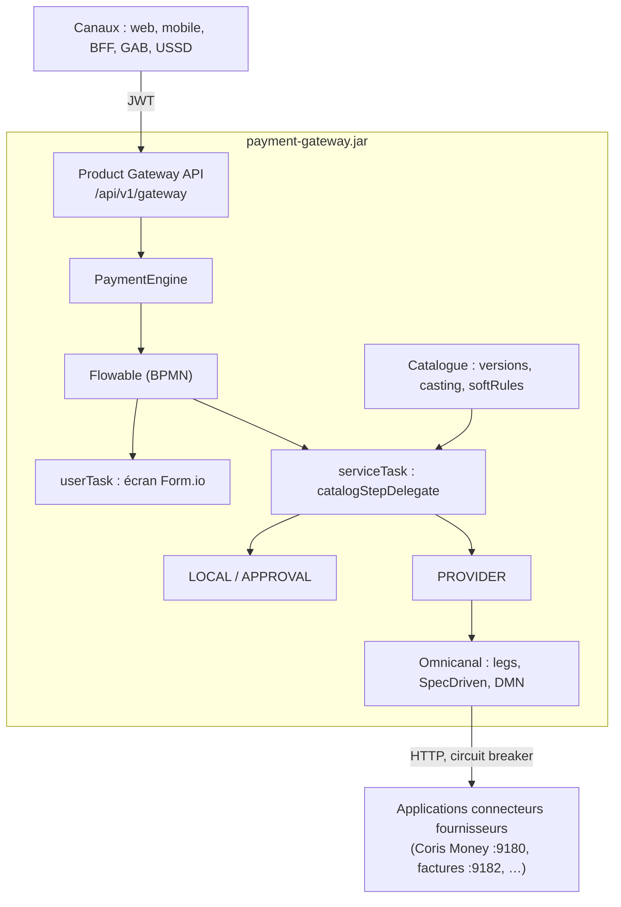
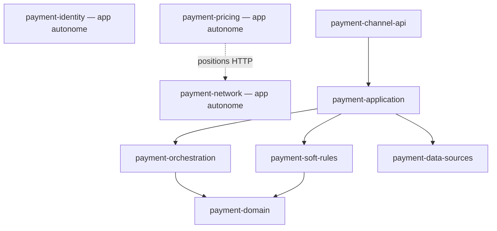
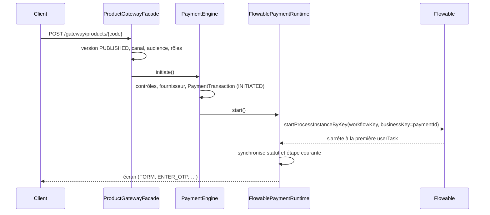

# Architecture de payment-2

Ce document décrit l'architecture de payment-2 (« Product Gateway ») : modules, responsabilités,
déroulé d'exécution d'un produit, sécurité, front et exploitation. Il se termine par les écarts
constatés dans le code au moment de la rédaction (octobre 2026).

Documents liés :

| Document | Contenu |
|---|---|
| [`DOCUMENTATION-TECHNIQUE.md`](DOCUMENTATION-TECHNIQUE.md) | **Doc technique complète** : modules, rôles, modèles de données, diagrammes de classes et de séquence, interactions, canaux |
| [`GUIDE-INTEGRATION-PRODUITS.md`](GUIDE-INTEGRATION-PRODUITS.md) | Guide pour un client (web, mobile, BFF…) qui exécute des produits |
| [`INTEGRATION.md`](INTEGRATION.md) | Référence détaillée du contrat `/api/v1/gateway` |
| [`CAPABILITIES.md`](CAPABILITIES.md) | Concept, implémentation et liste des capabilities |
| [`PERFORMANCE.md`](PERFORMANCE.md) | Plan de montée en charge (1000 tx/s, P99 < 1 s) |
| `architecture-plateforme.drawio` | Schéma de la plateforme |
| `postman/` | Collections Postman et environnement local |

---

## 1. Vue d'ensemble

payment-2 est une passerelle qui expose des **produits** (virement, paiement de facture,
rattachement de compte, SWIFT, RTGS, cash-in/out, remittance…) à des canaux clients, sans code
spécifique par produit ni par canal.

Un produit est **configuré**, pas codé. Il combine :

- un **processus BPMN** (Flowable) qui décrit l'enchaînement des étapes ;
- une **configuration catalogue** versionnée (JSONB) : rôles, fournisseurs, formulaires,
  règles, variantes par canal, politique de validation ;
- des **formulaires Form.io** pour les étapes de saisie ;
- des **capabilities** : briques métier réutilisables exécutées par les tâches de service.

Les fournisseurs (banques, opérateurs mobile money, facturiers…) sont appelés via **Omnicanal** :
le modèle d'interfaces et de schémas d'écriture compile des « legs » qui sont envoyés en HTTP à
des **applications connecteurs** externes.



---

## 2. Stack technique

| Domaine | Technologie |
|---|---|
| Langage / socle | Java 21, Spring Boot 3.3.5 (parent `spring-boot-starter-parent`) |
| Processus | Flowable 7.1 (BPMN + DMN) via `rapidframe-bpm` |
| Framework applicatif | RapidFrame backend `1.0.0-SNAPSHOT` (`rapidframe-core`, `-web`, `-bpm`) |
| Persistance | PostgreSQL 16, Spring Data JPA (`ddl-auto: validate`), Flyway (113 migrations, dernière V113) |
| Cache / verrous | Caffeine (local), Redis 7 optionnel (verrous distribués) |
| Résilience | Resilience4j (circuit breaker par fournisseur et méthode) |
| Sécurité | Spring Security, JWT HMAC (jjwt 0.12.6), BCrypt, clé API canal |
| Observabilité | Actuator, Micrometer / Prometheus, `traceId` dans les logs |
| Documentation API | springdoc (`/swagger-ui.html`) |
| Front | Angular 17.3, PrimeNG 17, Tailwind 4, Form.io, bpmn-js 17, dmn-js 17, libs `@rapidframe/*` |
| Messagerie | Aucune (ni Kafka ni RabbitMQ) |

---

## 3. Modules Maven

Artefact parent : `com.gateway:payment-parent:0.1.0-SNAPSHOT`.



| Module | Rôle | Fichiers Java |
|---|---|---|
| `payment-domain` | Couche de persistance partagée : entités JPA, enums, repositories, ports d'appel fournisseur. Aucun service. | 145 |
| `payment-orchestration` | Modèle Omnicanal : compilation des legs, sélection de schéma par DMN, exécuteur multi-legs SpecDriven (retry, compensation), API canal par clé API, idempotence, verrous. | 101 |
| `payment-soft-rules` | Moteur des `softRules` du catalogue (`CatalogSoftRuleEngine`) et SPI pour ajouter des types de règles. | 15 |
| `payment-data-sources` | Façade de résolution des sources de données des formulaires (LOCAL, OMNICANAL, GATEWAY) et SPI. | 20 |
| `payment-identity` | Annuaire d'identité métier (parties, arbre d'organisation, utilisateurs canal, rattachements) et **profils d'offre** (services + grilles tarifaires, affectés aux parties **et aux unités du réseau**). **Application Spring Boot autonome** (`payment-identity.jar`, port 8094, base dédiée `payment_identity`). Les alias de comptes sont dans payment-alias. | 29 |
| `payment-alias` | Alias de comptes (pointeurs stables vers CBS / Coris / till). Propriétaire : `PARTY` ou `ORG` (identity) ou `UNITE` (network). **Application Spring Boot autonome** (`payment-alias.jar`, port 8097, base dédiée `payment_alias`). | 12 |
| `payment-pricing` | Moteur de tarification (politiques, taux, limites, devis) et moteur de frais configurable : formules versionnées, grilles par produit / canal / devise / source et destination (toutes, une zone ou une unité du réseau, regroupement compris) / période, tranches à paramètres JSONB, validation, simulation, `POST /api/v1/frais/calculer`, tarif actuel d'un périmètre (`POST /api/v1/frais/grille-applicable`) ; sélection des grilles ciblées en SQL (lignée, regroupements, zone) et liste paginée, pour des milliers de grilles jusqu'au sous-distributeur. **Application Spring Boot autonome** (`payment-pricing.jar`, port 8095, base dédiée `payment_pricing`) ; elle valide les tokens Keycloak et ceux de l'ancien login payment-2. Pour choisir une grille ciblée, elle demande à payment-network la position de la transaction (`GET /api/v1/network/positions`, token relayé, cache court ; 503 `RESEAU_INDISPONIBLE` s'il est injoignable). Le gateway ne l'embarque plus et ne l'appelle pas encore. La console payment-front l'appelle pour les écrans Tarification. | 64 |
| `payment-network` | Réseau de distribution : zones monétaires administrables (UEMOA, CEMAC fournies ; code, libellé, devise), unités d'organisation dans l'arbre Pays > FSE > Agence > Master ou Marchand > Sous-distributeur (14 pays fournis, d'autres créables dans une zone active), et regroupements placés à n'importe quel niveau sous une unité, jamais à la racine (membres N-N pris dans la branche de leur parent, descendance couverte). **Application Spring Boot autonome** (`payment-network.jar`, port 8096, base dédiée `payment_network`) ; mêmes tokens que payment-pricing. La console payment-front l'appelle pour les écrans Réseau. Il fournit aussi à payment-pricing la position d'une unité, d'un pays ou d'une zone (lignée jusqu'au pays, regroupements couvrants). Dimensionné pour des milliers d'unités : listes paginées côté serveur, arbre chargé nœud par nœud, import en masse CSV / Excel (contrôle à blanc puis application tout ou rien, Apache POI). | 30 |
| `payment-application` | Toute la logique métier : moteur de paiement, runtime Flowable, catalogue, capabilities, fournisseurs, validation, sécurité, API. | 325 |
| `payment-channel-api` | Application exécutable : classe `PaymentGatewayApplication`, configuration, BPMN, formulaires, DMN, migrations. Produit `payment-gateway.jar`. | 1 |

### 3.1 payment-domain

Packages principaux (`com.gateway.payment.*`) :

| Package | Contenu |
|---|---|
| `payment` | `PaymentTransaction`, `PaymentExecution`, `PaymentEvent`, `PaymentCallback` |
| `catalog` | `CatalogDeService`, `CatalogDeServiceVersion`, `CatalogDeServiceStatus`, `CategorieService` |
| `configuration` | `PaymentProvider`, `ProviderOperation`, `ProviderApi`, `ProviderFseApi`, `ProviderEnvironment`, `PaymentFlow`, `ServiceType` |
| `orchestration` | `InterfaceUtilisateur`, `ParametreUtilisateur`, `SchemaEcriture`, `LigneSchemaEcriture`, `CompteFse`, `RelationFse` |
| `approval` | `ApprovalInstance`, `ApprovalStepInstance`, `ApprovalDecision`, `ApprovalProfileEntity` |
| `transfer` | `TransferOrder`, `TransferRail`, `TransferCorridor`, `FeeRule`, `TransferFeePolicy` |
| `billing` | `Biller`, `BillerProduct`, `BillerCategory`, `AmountPolicy` |
| `security` | `GatewayUser`, `GatewayRole`, `RoleCode` |
| `provider` | `ProviderInvocationPort` (port d'appel fournisseur), `ProviderExecutionResult` |
| `common` | `PaymentStatus`, `PaymentStatusTransitionGuard`, `AccessChannel`, `BusinessException` |
| autres | `audit`, `document`, `i18n`, `schedule` |

### 3.2 payment-orchestration

| Package | Rôle |
|---|---|
| `orchestration.service` | `LegCompilerService` (interface + paramètres → leg), `SchemaLegExecutorService`, `SchemaMatchingService` |
| `omnicanal.spec` | `SpecDrivenTransferExecutor` : exécution des legs par vagues, en parallèle si indépendants |
| `omnicanal.policy` | Retry, timeout, compensation, classification d'erreurs |
| `omnicanal.schema` | `WorkflowSelectService` : choix du schéma d'écriture par DMN `schema-matching` |
| `omnicanal.canal` | API canal par clé `X-Api-Key` (`/api/v1/boundaryByTypeMethode`, `/omnicanalPresentation`, `/canal/compile-leg`) |
| `omnicanal.idempotency`, `omnicanal.concurrency`, `common.concurrency` | Clé d'idempotence, réservation d'étapes, verrous mémoire ou Redis |
| `omnicanal.flowable` | `CallFseCompensateDelegate` (compensation depuis le BPMN) |
| `orchestration.api` | Administration : schémas d'écriture, comptes FSE, corridors, interfaces utilisateur |

### 3.3 payment-application

| Package | Rôle |
|---|---|
| `integration` | Product Gateway externe (`/api/v1/gateway`) : `ProductGatewayController`, `ProductGatewayFacade`, `IntegrationScreenMapper` |
| `payment` | Moteur de paiement (`PaymentEngine`), appels fournisseur (`ProviderInvocationService`, `ConnectorHttpInvoker`), API `/api/v1/payments` |
| `bpm` | Runtime Flowable (`FlowablePaymentRuntime`), délégués, `ProviderCallOperationRegistry`, `CatalogProviderInvoker`, calcul de l'écran suivant |
| `catalog` | Catalogue de services (voir ci-dessous) |
| `approval` | Moteur de validation maker/checker (`ApprovalEngine`), API `/api/v1/approvals` |
| `configuration` | Administration des fournisseurs (`/api/v1/providers/**`) : APIs, environnements, opérations, OTP, webhooks, mappings de statuts |
| `transfer`, `billing`, `remittance`, `schedule`, `document` | Domaines métier : transferts et frais, facturiers, remittance, paiements planifiés, pièces justificatives |
| `security` | Authentification (`/api/v1/auth`), JWT, utilisateurs admin |
| `webhook` | Réception des callbacks fournisseurs (`/api/v1/webhooks`) |
| `observability`, `audit`, `common` | Métriques, circuit breakers, audit, chiffrement des secrets (AES-GCM), i18n, gestion d'erreurs |

Sous-packages de `catalog` :

| Sous-package | Rôle |
|---|---|
| `api` | API d'administration du catalogue et vocabulaire des étapes (`/catalog/capabilities`) |
| `service` | CRUD produits / versions, résolution de la version publiée (cache Caffeine), flux hôte technique |
| `capability` | Les 28 capabilities, registre, résolveur, dispatcher — voir [`CAPABILITIES.md`](CAPABILITIES.md) |
| `bpmn` | Liaison produit ↔ processus déployé, attributs `pay:*`, contrôle des étapes à la publication |
| `casting` | Rôles, participants, bindings ; résolution du formulaire d'une étape |
| `journey`, `gateway` | Canaux, audiences, politique de montant, réglages `gateway` |
| `presentation`, `datasource` | Sections de présentation, adaptateurs vers le SPI data-sources, 8 sources LOCAL |
| `omnicanal` | Pont entre les étapes catalogue et Omnicanal (`OmnicanalCatalogInvocationService`) |
| `recap`, `document`, `i18n` | Schémas Form.io générés (récapitulatif, upload de pièces), traduction des libellés |

---

## 4. Le catalogue de services

### 4.1 Modèle

- **Produit** (`catalog_de_service`) : code, catégorie, statut, version courante.
- **Version** (`catalog_de_service_version`) : numéro, statut, période de validité,
  `workflow_key` (clé du processus BPMN) et `configuration` (JSONB).
- Statuts de version : `DRAFT`, `VALIDATED`, `PUBLISHED`, `SUSPENDED`, `ARCHIVED`.
  Seule une version `DRAFT` est modifiable.
- Chaque transaction référence la version exacte avec laquelle elle a été exécutée.

### 4.2 Contenu de la configuration

| Section | Rôle |
|---|---|
| `roles[]` | Rôles du produit (`SOURCE`, `DESTINATION`, `PAYER`, `BILLER`, `BENEFICIARY`, `CORRESPONDENT`, `PROVIDER`, `AGENT_NETWORK`), cardinalité (`ONE_REQUIRED`, `ONE_OPTIONAL`, `MANY`), sélection (`USER`, `FIXED`, `DERIVED`) |
| `participants[]` | Fournisseurs rattachés à chaque rôle, avec un participant par défaut |
| `bindings[]` | Par étape : kind (`UI`, `INVOKE`, `SOFT`, `WAIT`, `APPROVAL`, `CAPABILITY`), formulaire, rôle, opération, capability, paramètres |
| `softRules[]` | Règles par étape (`REQUIRED_FIELD`, `REGEX_FIELD`, `MIN_AMOUNT`, `BLOCKED_VALUES`, `BUSINESS_HOURS`, `DEFAULT_FEE`, `GENERATE_CODE`, `PASS`) |
| `channelDefaults` | Surcharges par canal (bindings, softRules, réglages) |
| `supportedChannels`, `supportedAudiences` | Canaux (`MOBILE`, `WEB`, `GAB`, `USSD`, `BACKOFFICE`) et audiences (`RETAIL`, `CORPORATE`, `AGENT`, `MERCHANT`, `BACKOFFICE`) |
| `approvalPolicy` | Politique de validation maker/checker (voir section 6) |
| `gateway`, `presentation` | Flux hôte technique, présentation catalogue |

Depuis V113, le comportement des tâches de service se déclare de préférence **dans le BPMN**
(`pay:capability`, `pay:actorRole`, `pay:operation`) ; la configuration catalogue garde les
bindings UI, les règles et les variantes canal. Un binding catalogue qui porte une `capability`
surcharge la tâche.

### 4.3 Publication

`POST /api/v1/admin/catalog-services/versions/{versionId}/publish`
(ou `POST /products/publish` pour créer et publier en un appel) :

1. contrôle du casting ;
2. vérification que le processus BPMN est **déjà déployé** (il n'est jamais généré) ;
3. contrôle des tâches de service (`CatalogWorkflowStepValidator`) — une capability ou un rôle
   inconnu bloque la publication (`CATALOG_WORKFLOW_INVALID`) ;
4. archivage de la version publiée précédente ;
5. passage en `PUBLISHED`, mise à jour de la version courante ;
6. création du flux hôte technique si configuré ;
7. invalidation du cache de résolution des produits.

Les processus, formulaires et DMN sont déployés au démarrage depuis
`payment-channel-api/src/main/resources/modules/payment-admin-module/`
(21 processus BPMN, environ 70 formulaires, 3 DMN).

---

## 5. Exécution d'un produit

### 5.1 Contrat client

Le client tourne en boucle sur un seul contrat (`/api/v1/gateway`, JWT requis) :

1. `POST /products/{code}` démarre le produit et renvoie le premier écran ;
2. le client affiche l'écran (`IntegrationScreenResponse`) ;
3. `POST /payments/{paymentId}/actions` soumet la saisie (`SUBMIT_FORM`, `SUBMIT_OTP`,
   `CONFIRM`, `CONTINUE`, `CHECK_STATUS`, `APPROVE`, `REJECT`) ;
4. on recommence jusqu'à un écran `SUCCESS` ou `FAILURE`.

Types d'écran : `FORM`, `ENTER_OTP`, `WAIT` (relance après 3 s), `REDIRECT`, `SUCCESS`, `FAILURE`.
La liste des produits publiés est fournie par `GET /api/v1/admin/catalog-services/published`
(accessible à tout utilisateur authentifié). Détails : [`GUIDE-INTEGRATION-PRODUITS.md`](GUIDE-INTEGRATION-PRODUITS.md).

### 5.2 Démarrage



Points clés :

- l'identifiant de paiement a la forme `PAY-yyyyMMdd-NNNNNN-XXXXXX` ;
- le contexte de la transaction (JSON) contient la saisie, la configuration effective du canal
  (`catalogConfiguration`), les affectations de rôles et l'initiateur ;
- Flowable s'exécute **de façon synchrone dans la requête HTTP** (exécuteur asynchrone désactivé),
  jusqu'à la prochaine tâche utilisateur ou la fin du processus ;
- le mode est fixé par `gateway.orchestration.mode: flowable`.

### 5.3 Tâches utilisateur

Une `userTask` porte un `formKey`. À chaque arrêt, le statut est synchronisé :

| Tâche | Statut de la transaction |
|---|---|
| OTP | `OTP_REQUIRED` |
| Validation | `WAITING_APPROVAL` |
| Retour pour correction | `RETURNED_FOR_CORRECTION` |
| Attente | `REDIRECT_REQUIRED` ou `WAITING_CALLBACK` |
| Autre saisie | `AWAITING_USER_INPUT` |
| Fin du processus | `SUCCESS` (sauf si déjà `FAILED` ou `CANCELLED`) |

Le formulaire est résolu dans cet ordre : binding explicite du fournisseur, convention
`{produit}-{rôle}-{fournisseur}`, binding partagé, `formKey` du BPMN. Le schéma Form.io est
localisé, ses sources de données sont remplies et les champs déjà saisis sont retirés.
Les données sensibles et l'OTP ne sont jamais enregistrés dans le contexte.

### 5.4 Tâches de service

Toutes les `serviceTask` utilisent `${catalogStepDelegate}`, qui résout la **capability** de
l'étape et l'aiguille :

| Chemin | Délégué | Exemple |
|---|---|---|
| LOCAL | `CatalogProductStepDelegate` | `VALIDATE_ACCOUNT`, `CALCULATE_FEES`, `NOTIFY` |
| PROVIDER | `GatewayProviderCallDelegate` | `GENERATE_OTP`, `EXECUTE_TRANSFER`, `PAY_BILL` |
| APPROVAL | `TransferApprovalEvaluateDelegate` | `EVALUATE_APPROVAL` |

Le fonctionnement détaillé est décrit dans [`CAPABILITIES.md`](CAPABILITIES.md).

### 5.5 Appel fournisseur

1. `ProviderCallOperationRegistry` donne le rail (`PRIMARY`, `PAYER`, `BILLER`) et le
   comportement en cas de succès de l'opération.
2. `CatalogProviderInvoker` choisit le fournisseur : affectation du rôle acteur, sinon rail,
   sinon fournisseur de la transaction.
3. `OmnicanalCatalogInvocationService` exécute l'appel :
   - transferts : `executeTransfer` → DMN `schema-matching` → `SpecDrivenTransferExecutor`
     (plusieurs legs, compensation) ;
   - autres opérations : `invokeOperation` → un leg via `SchemaLegExecutorService`.
4. `ProviderInvocationService` applique le circuit breaker, journalise l'appel
   (`payment_execution`) et appelle `ConnectorHttpInvoker` (Spring `RestClient`) vers l'URL du
   connecteur, avec des secrets déchiffrés à la volée.

Il n'existe plus de chemin d'appel direct : si Omnicanal est désactivé
(`gateway.catalog.omnicanal.enabled=false`), l'appel échoue (`INTERFACE_PATH_DISABLED`).

En cas de dépassement de délai, la transaction passe en `UNKNOWN` (`PROVIDER_TIMEOUT`) ;
en cas d'échec, en `FAILED` (`PROVIDER_FAILED`).

---

## 6. Validation maker / checker

- **Politique** : `configuration.approvalPolicy` (activation, clé DMN, champs critiques,
  initiateur autorisé ou non, même valideur sur plusieurs niveaux ou non).
- **Évaluation** (`EVALUATE_APPROVAL` → `ApprovalEngine.start`) : la DMN
  `transfer-approval` choisit un profil selon montant, devise, produit, rail, type de client… ;
  le profil définit les niveaux et les groupes valideurs :

  | Profil | Niveaux |
  |---|---|
  | `NO_APPROVAL` | aucun |
  | `LEVEL_1` | L1 : `CHEF_AGENCE` |
  | `LEVEL_1_2` | L1 : `CHEF_AGENCE`, L2 : `RESPONSABLE_OPERATIONS` |
  | `HIGH_VALUE` | L1 : `CHEF_AGENCE`, L2 : `RESPONSABLE_OPERATIONS` ×2, L3 : `DIRECTEUR` |

- **BPMN** : une passerelle teste `approvalLevelsRequired`, puis des tâches `APPROVAL_L1..L3`
  avec `candidateGroups`. Un refus renvoie vers une tâche de correction puis la confirmation.
- **Décision** (`POST /api/v1/approvals/{paymentId}/decide`) : contrôles d'auto-validation
  (`SELF_APPROVAL_FORBIDDEN`), de même valideur sur plusieurs niveaux, d'empreinte des champs
  critiques (une modification invalide la validation) et de double décision. Une validation
  partielle laisse la transaction en `WAITING_APPROVAL`.
- La boîte de réception (`/api/v1/approvals/inbox`) est filtrée par groupe valideur.

---

## 7. Callbacks, asynchronisme et reprise

- **Webhooks** : `POST /api/v1/webhooks/{provider}` est ouvert au niveau HTTP ; l'appelant est
  authentifié par la configuration du fournisseur (`API_KEY`, `HMAC` SHA-256, liste d'IP ou
  aucune). Les callbacks sont dédupliqués (`payment_callback`) et le statut fournisseur est
  converti par les mappings de statuts. Un callback sur une transaction terminale est ignoré.
- **Attentes** : les étapes `WAIT_*` sont des tâches de service ; elles posent un message ou un
  statut mais **ne suspendent pas** le processus (aucun receive task, message ou timer).
- **Pas de tâche planifiée** : aucun job d'expiration, de timeout ou de rapprochement.
  La reprise est manuelle (`POST /api/v1/payments/{id}/retry` depuis `UNKNOWN`, `PENDING` ou
  `FAILED`, puis interrogation du statut fournisseur).

---

## 8. Traçabilité et audit

| Table / composant | Contenu |
|---|---|
| `payment_event` | Événements métier d'une transaction (création, étapes, appels, OTP, validation, callbacks), écrits en asynchrone ; lus via `GET /api/v1/payments/{id}/events` |
| `payment_execution` | Un enregistrement par appel fournisseur (requête, réponse, statut HTTP, durée) |
| `payment_callback` | Callbacks reçus (déduplication) |
| `approval_instance`, `approval_step_instance`, `approval_decision` | Historique des validations |
| `audit_log` | Actions d'administration (fournisseurs, flux, webhooks, OTP, connexion) ; lu via `/api/v1/admin/audit` |
| `ApiAuditFilter` | Journal de chaque requête `/api/v1/**` (logger `API_AUDIT` + métriques, pas de base) |

La capability `NOTIFY` enregistre un événement et clôt la transaction ; **aucun envoi** (SMS,
e-mail, push) n'est implémenté.

---

## 9. Sécurité

- **Authentification** : JWT sans état (`/api/v1/auth/login`, `/auth/refresh`), jeton d'accès
  15 min, jeton de rafraîchissement 7 j ; autorités `ROLE_<code>` issues de `gateway_role`.
- **Clé API canal** : `X-Api-Key` sur `/api/v1/canal/**` et les endpoints Omnicanal
  (`ROLE_CANAL`), une seule clé (`CANAL_API_KEY`).
- **Règles d'accès** (`SecurityConfig`) :
  - publics : authentification, ping, i18n, santé, Swagger, `POST /api/v1/webhooks/**` ;
  - `/api/v1/admin/**`, `/api/bpm/**`, `/api/dmn/**` : `ADMIN`, `CONFIG_MANAGER`, `SUPPORT`,
    `AUDITOR` ou `OPERATOR`, affinés par `@PreAuthorize` ;
  - le reste : utilisateur authentifié.
- **Rôles** : `ADMIN`, `CONFIG_MANAGER`, `OPERATOR`, `SUPPORT`, `AUDITOR`, `CHEF_AGENCE`,
  `RESPONSABLE_OPERATIONS`, `DIRECTEUR`.
- **Secrets fournisseurs** chiffrés en AES-GCM (`ENCRYPTION_SECRET`).
- **CORS** configurable (`CORS_ORIGINS`).

---

## 10. Front : payment-front

Application Angular 17 unique, avec deux usages :

- **parcours produits** (`/products`, `/products/:code`, `/history`) : moteur générique qui
  affiche les écrans renvoyés par le gateway (Form.io, OTP, attente, redirection) ;
- **console d'administration** (`/admin`, dans le shell RapidFrame) : catalogue de services,
  fournisseurs, orchestration Omnicanal, transferts et frais, tarification (grilles paginées, tranches,
  formules, simulateur, servis par payment-pricing ; source et destination choisies en cascade
  Pays › FSE › Agence › Master ou marchand › Sous-distributeur avec recherche rapide, et encart « tarif actuel »
  du périmètre saisi), réseau (arbre par zone chargé à la demande, unités
  d'organisation paginées, regroupements, zones, import en masse, servis par payment-network),
  identité (profils d'offre : services + grilles, affectation aux parties et aux unités réseau, servis par payment-identity),
  facturiers, validations, transactions,
  utilisateurs, audit, tableau de bord ;
- **concepteurs** : formulaires (Form.io), BPMN (`/bpmn-designer`, avec le panneau
  « Capability (étape) ») et DMN.

| Élément | Détail |
|---|---|
| API | `environment.apiUrl = /api/v1` (gateway), `pricingApiUrl = /api/v1` (payment-pricing), `networkApiUrl = /api/v1/network` (payment-network), `identityApiUrl = /api/v1/identity` (payment-identity), `aliasApiUrl = /api/v1/aliases` (payment-alias), `rapidframeApiUrl = /api` (RapidFrame) |
| Proxy dev | `proxy.conf.json` : pricing → `8095` ; network → `8096` ; identity → `8094` ; aliases → `8097` ; le reste de `/api` → `8080` |
| Authentification | `AuthService`, intercepteur `Bearer`, `authGuard` et `roleGuard` |
| Form.io | `shared/formio/` : construction de schéma, sources de données en cascade (`rfDataSource`), affichage conditionnel |
| Libs RapidFrame | `@rapidframe/frontend-angular`, `bpmn-designer`, `formio-designer`, `core`, copiées depuis `monApp/rapidframe-frontend` par `scripts/sync-rapidframe-libs.mjs` (qui purge aussi le cache Vite) |

Scripts npm : `npm start` (synchronise les libs puis `ng serve` sur le port 4200),
`npm run build`, `npm run refresh:libs` (reconstruit les libs RapidFrame puis synchronise).

---

## 11. Configuration et exploitation

### 11.1 Profils Spring

| Profil | Usage |
|---|---|
| `prod` | **Profil par défaut** (`spring.profiles.default: prod`) ; secrets JWT, CORS et chiffrement obligatoires par variables d'environnement ; pools et threads dimensionnés |
| `local` | PostgreSQL `localhost:5432/payment_gateway`, Redis, fournisseurs de démonstration, logs DEBUG |
| `dev` | H2 en mémoire (mode PostgreSQL), console `/h2-console` |
| `test` | Base `payment_gateway_test`, sans Redis |

Variables d'environnement principales : `DB_*` / `SPRING_DATASOURCE_URL`, `REDIS_HOST`,
`REDIS_PORT`, `GATEWAY_REDIS_ENABLED`, `JWT_SECRET`, `ENCRYPTION_SECRET`, `CORS_ORIGINS`,
`CANAL_API_KEY`, `SERVER_PORT`, `BILL_CONNECTOR_URL`, `RF_MODULES_PATH`, `RF_DOMAINS_PATH`,
`RF_VIEWS_PATH` (voir `.env.example`).

### 11.2 Lancer en local

```bash
# Infrastructure
docker compose up -d postgres redis

# Backend (Java 21)
./mvnw -pl payment-channel-api -am package -DskipTests
cd payment-channel-api
java -jar target/payment-gateway.jar --spring.profiles.active=local
# ou : ./mvnw -pl payment-channel-api -am spring-boot:run (profil Maven local par défaut)

# Front
cd payment-front && npm install && npm start   # http://localhost:4200
```

Sans `--spring.profiles.active=local`, le jar démarre en profil `prod`. Lancé depuis la racine du
dépôt, il faut renseigner `RF_MODULES_PATH`, `RF_DOMAINS_PATH` et `RF_VIEWS_PATH`.

Swagger : `http://localhost:8080/swagger-ui.html`. Santé : `/actuator/health`.

### 11.3 Déploiement

`docker-compose.yml` : PostgreSQL 16, PgBouncer (pooling transactionnel), Redis 7 et le backend
en 3 réplicas (profil `prod`, base via PgBouncer). Le backend est construit avec
`payment-channel-api/Dockerfile`. Pas de manifeste Kubernetes ni Helm.

Tests de charge k6 : `scripts/load/`.

### 11.4 Tests

| Module | Tests |
|---|---|
| `payment-application` | 25 classes, ~98 méthodes |
| `payment-orchestration` | 6 classes, ~20 méthodes |
| `payment-data-sources` | 3 classes, ~10 méthodes |
| `payment-domain`, `payment-soft-rules` | 2 classes chacun, ~7 méthodes chacun |
| `payment-identity` | 2 classes (sécurité JWT / erreurs du contrôleur ; profils d'offre), 14 méthodes |
| `payment-pricing` | 11 classes (formules, validation, moteur, ciblage source/destination, service des grilles, contrôleurs, sécurité JWT, intégration PostgreSQL via Testcontainers, volume de 2 000 grilles ciblées), 116 méthodes |
| `payment-network` | 9 classes (matrice de rattachement, couverture, services des zones, des unités et des regroupements, lecture des fichiers d'import, contrôleurs, intégration PostgreSQL via Testcontainers dont import et volume de 6 240 unités), 99 tests |
| `payment-channel-api` | aucun |
| `payment-front` | Karma / Jasmine configurés, aucun fichier `*.spec.ts` |

Ce sont des tests unitaires (JUnit 5, Mockito, AssertJ) ; aucun test d'intégration
`@SpringBootTest`.

---

## 12. Exemples de déroulé

### 12.1 Rattachement de compte (`LINK`, processus `accountLink`)

Configuration : rôle `SOURCE` (choisi par l'utilisateur parmi Wave, Orange Money, Coris Money),
softRules sur `VALIDATE_ACCOUNT` (téléphone obligatoire, format `^[0-9+]{8,15}$`).

| # | Action client | Ce qui s'exécute | Écran renvoyé |
|---|---|---|---|
| 1 | `POST /gateway/link` | Création (`INITIATED`), démarrage du processus | `FORM` choix du fournisseur |
| 2 | `SUBMIT_FORM` fournisseur | Affectation du rôle `SOURCE` | `FORM` saisie du compte |
| 3 | `SUBMIT_FORM` compte | `VALIDATE_ACCOUNT` (LOCAL, softRules) | `FORM` récapitulatif |
| 4 | `SUBMIT_FORM` confirmation | `GENERATE_OTP` (PROVIDER, `SOURCE`) | `ENTER_OTP` |
| 5 | `SUBMIT_OTP` | `EXECUTE_LINK` (PROVIDER, opération `LINK`) puis `NOTIFY` | `SUCCESS` |

### 12.2 Transfert de compte à compte (`ACCOUNT_TRANSFER`, processus `accountTransfer`)

| # | Action | Ce qui s'exécute | Résultat |
|---|---|---|---|
| 1 | `POST /gateway/account-transfer` | Création, démarrage | `FORM` destination |
| 2 | `SUBMIT_FORM` | Contrôle du compte (softRules) | `FORM` montant |
| 3 | `SUBMIT_FORM` | — | `FORM` compte source |
| 4 | `SUBMIT_FORM` | Contrôles solde, limites, calcul des frais | `FORM` confirmation |
| 5 | `SUBMIT_FORM` | `EVALUATE_APPROVAL` (DMN → profil) | sans validation : étape 7 ; sinon `WAIT` (`WAITING_APPROVAL`) |
| 6 | Valideur : `POST /approvals/{id}/decide` | Contrôles maker/checker, niveau suivant ou suite | refus : retour pour correction |
| 7 | — | `GENERATE_OTP` (`SOURCE`) | `ENTER_OTP` |
| 8 | `SUBMIT_OTP` | Débit, `EXECUTE_TRANSFER` (SpecDriven, legs SOURCE et DESTINATION), `NOTIFY` | `SUCCESS` |

---

## 13. Écarts et points d'attention constatés

Ces points ont été relevés dans le code et la configuration ; ils ne sont pas corrigés.

### Sécurité

| Constat | Impact |
|---|---|
| La décision de validation ne vérifie pas que le valideur appartient au groupe de l'étape (`candidateGroups`) ; seule la boîte de réception est filtrée. | Tout utilisateur authentifié autre que l'initiateur, connaissant un `paymentId`, peut valider. |
| Aucun contrôle de propriété sur `/gateway/payments/{id}`, `/payments/{id}` et l'historique (filtré par paramètres, pas par utilisateur). | Un utilisateur authentifié peut consulter les transactions d'autrui. |
| Clé API canal unique, avec une valeur par défaut (`change-me-mobile`) hors profil `prod`. | À surcharger systématiquement. |
| Pas de notion de tenant / institution sur les transactions ; le service `payment-identity` (app autonome) n'est appelé par aucun module du gateway. | Isolation multi-entité absente. |

### Fonctionnel

| Constat | Impact |
|---|---|
| Aucun job d'expiration, de timeout ou de rapprochement. | Les transactions `UNKNOWN` / `PENDING` exigent une reprise manuelle. |
| Les étapes `WAIT_*` ne suspendent pas le processus. | Le statut `WAITING_CALLBACK` n'est pas une vraie attente de callback. |
| Échec fournisseur levé dans un délégué : l'état Flowable et le statut sont probablement annulés (transaction commune), alors que les événements écrits en asynchrone restent. *(Déduit, non testé.)* | L'historique peut montrer un échec que le statut ne reflète pas. |
| `NOTIFY` n'envoie rien. | Notification client à implémenter. |
| `payment-pricing` n'est pas utilisé ; les frais viennent des softRules (`DEFAULT_FEE`) et des tables `FeeRule` / `TransferFeePolicy`. | Deux sources de tarification. |
| DMN `transfer-approval` : seuil `LEVEL_1` ≤ 100 XOF, incohérent avec la description du profil (1 M – 10 M) ; deux fichiers DMN (`decisions/` et `rules/`) coexistent. | Seuil vraisemblablement de test ; fichier effectif à confirmer. |

### Build et documentation

| Constat | Impact |
|---|---|
| Le `Dockerfile` copie 4 des 8 modules et utilise Java 17 alors que le `pom.xml` exige Java 21. | Build Docker probablement cassé. |
| Le README indique Java 17 et Angular 19 ; le code utilise Java 21 et Angular 17. | Documentation à mettre à jour. |
| Le README présente `local` comme profil par défaut ; c'est vrai via Maven, pas avec `java -jar` (défaut `prod`). | Risque de démarrage en profil production. |
| La commande de test du README cible `payment-channel-api`, qui n'a aucun test Java. | Commande à corriger. |
| Commentaires et Javadoc indiquent `orchestration.mode: engine` alors que la valeur est `flowable`. | Commentaires à aligner. |
