# Documentation technique — plateforme payment-2

**Version :** 0.1.0-SNAPSHOT  
**Date :** octobre 2026  
**Périmètre :** modules Maven, applications autonomes, modèles de données, interactions, canaux clients.

Documents complémentaires : [`ARCHITECTURE.md`](ARCHITECTURE.md), [`INTEGRATION.md`](INTEGRATION.md), [`GUIDE-INTEGRATION-PRODUITS.md`](GUIDE-INTEGRATION-PRODUITS.md), [`GUIDE-CONFIGURATION-PRODUIT.md`](GUIDE-CONFIGURATION-PRODUIT.md).

---

## Table des matières

1. [Vue d’ensemble](#1-vue-densemble)
2. [Cartographie des modules](#2-cartographie-des-modules)
3. [Applications et ports](#3-applications-et-ports)
4. [Authentification](#4-authentification)
5. [Bounded contexts & modèles de données](#5-bounded-contexts--modèles-de-données)
6. [Interactions entre modules](#6-interactions-entre-modules)
7. [Diagrammes de séquence](#7-diagrammes-de-séquence)
8. [Canaux clients](#8-canaux-clients)
9. [Contrats API (résumé)](#9-contrats-api-résumé)
10. [Déploiement local](#10-déploiement-local)

---

## 1. Vue d’ensemble

**payment-2** est une plateforme de paiement « Product Gateway » : les produits (virement, facture, cash-in/out, RTGS, SWIFT…) sont **configurés** (BPMN + catalogue + Form.io + capabilities), pas codés par canal.

Autour du gateway se sont détachés des **bounded contexts** (BC) autonomes :

| BC | Responsabilité |
|----|----------------|
| **Gateway** (`payment-channel-api`) | Orchestration produit, transactions, catalogue, Omnicanal, outbox/events |
| **Identity** | Parties, org, utilisateurs canal, **profils d’offre** |
| **Alias** | Pointeurs stables vers comptes CBS / till / wallet |
| **Network** | Arbre de distribution (pays → FSE → agence → …) + regroupements |
| **Pricing** | Formules, grilles tarifaires, calcul de frais (`feeBaseAmount` = assiette appelant) |
| **Rules** | Plafonds / cumuls réglementaires (≠ soft-rules catalogue) |
| **Commission** | Grilles, simulation, **droits accrues + liquidation** |

Chemin live gateway : `CALCULATE_FEES` → pricing ; `EVALUATE_RULES` → rules (réserve) ; SUCCESS → confirm + commission accrue ; FAIL/CANCEL → release.

Les canaux (console admin, corporate, mobile retail, mobile agent) consomment ces API via JWT Keycloak.

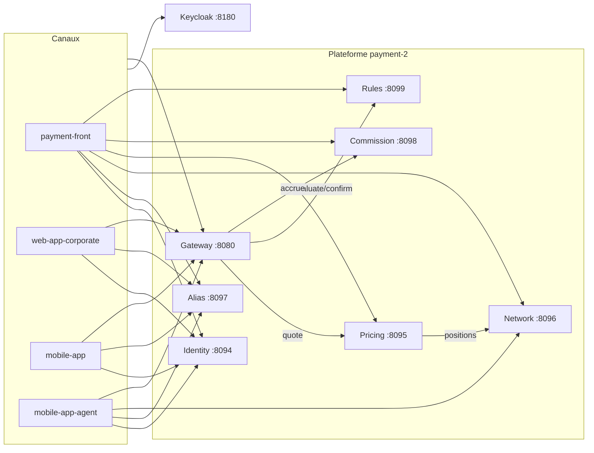

---

## 2. Cartographie des modules

Artefact parent : `com.gateway:payment-parent:0.1.0-SNAPSHOT` (Java 21, Spring Boot 3.3.5).

### 2.1 Bibliothèques (embarquées dans le gateway)

| Module | Rôle |
|--------|------|
| `payment-domain` | Entités JPA, enums, repositories, contrats fournisseur — **pas de service métier** |
| `payment-orchestration` | Omnicanal : legs, SpecDriven, DMN schéma, API canal `X-Api-Key` |
| `payment-soft-rules` | Moteur des `softRules` catalogue |
| `payment-data-sources` | Résolution des sources de données formulaires (LOCAL / OMNICANAL / GATEWAY) |
| `payment-application` | Logique gateway : PaymentEngine, Flowable, catalogue, approbations, sécurité |

### 2.2 Applications Spring Boot autonomes

| Module | Artefact | Port | Base PostgreSQL |
|--------|----------|------|-----------------|
| `payment-channel-api` | `payment-gateway.jar` | **8080** | `payment_gateway` (:5432) |
| `payment-identity` | `payment-identity.jar` | **8094** | `payment_identity` (:5436) |
| `payment-pricing` | `payment-pricing.jar` | **8095** | `payment_pricing` (:5437) |
| `payment-network` | `payment-network.jar` | **8096** | `payment_network` (:5438) |
| `payment-alias` | `payment-alias.jar` | **8097** | `payment_alias` (:5439) |
| `payment-commission` | `payment-commission.jar` | **8098** | `payment_commission` (:5440) |
| `payment-rules` | `payment-rules.jar` | **8099** | `payment_rules` (:5441) |

### 2.3 Dépendances Maven (compile-time)

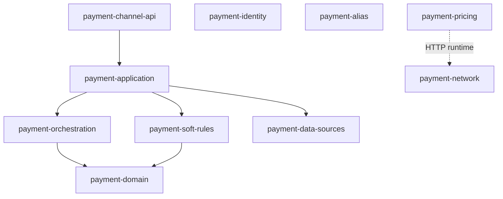

Les BC identity / alias / network / pricing **ne dépendent pas** les uns des autres en Maven (sauf pricing → network en HTTP runtime).

---

## 3. Applications et ports

| Service | URL locale typique | Santé |
|---------|-------------------|--------|
| Gateway | http://localhost:8080 | `/actuator/health` |
| Identity | http://localhost:8094 | `/actuator/health` |
| Pricing | http://localhost:8095 | `/actuator/health` |
| Network | http://localhost:8096 | `/actuator/health` |
| Alias | http://localhost:8097 | `/actuator/health` |
| Commission | http://localhost:8098 | `/actuator/health` |
| Rules | http://localhost:8099 | `/actuator/health` |
| Keycloak | http://localhost:8180 | realm `payment` |
| Redis (gateway) | :6379 | optionnel |

Fronts (hors Maven) :

| Front | Port démo | Client Keycloak |
|-------|-----------|-----------------|
| `payment-front` | 4200 | `payment-front` |
| `web-app-corporate` | 4210 | `web-app-corporate` |
| `mobile-app` | 4205 / 8100 | `payment2-mobile` |
| `mobile-app-agent` | 4206 | `mobile-agent` |

---

## 4. Authentification

- **Realm Keycloak :** `payment`
- **Audience API :** `payment-api`
- **Consommateurs JWT (resource servers) :** gateway, identity, pricing, network, alias  
  - Mode dual : JWKS Keycloak (RS256) **ou** JWT HMAC legacy (`issuer=payment-gateway`) pour compatibilité paymentHub2
- Les BC **ne partagent pas** les utilisateurs métier : Keycloak authentifie ; Identity décrit parties / users canal

---

## 5. Bounded contexts & modèles de données

### 5.1 payment-identity

**Rôle.** Annuaire métier et **profils d’offre** (ce qu’un acteur peut consommer : services catalogue + grilles pricing), **pas** les rôles admin RBAC.

**Concepts clés :**

| Concept | Table / entité | Description |
|---------|----------------|-------------|
| Party | `IdentityParty` | Personne ou organisation |
| OrgNode | `IdentityOrgNode` | Arbre entité / sous-entité |
| ChannelUser | `IdentityChannelUser` | Utilisateur canal (username ↔ party, audience) |
| Membership | `IdentityMembership` | User ↔ org + scope |
| Profile | `IdentityProfile` (+ services, grids) | Gabarit d’offre |
| PartyProfile | `IdentityPartyProfile` | Affectation profil → Party |
| UniteProfile | `IdentityUniteProfile` | Affectation profil → unité réseau (UUID logique) |

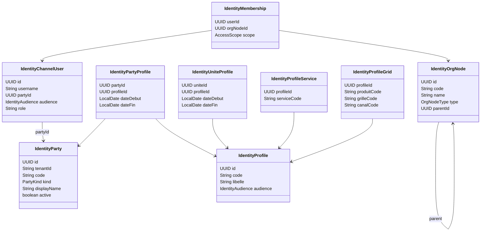

**Offre résolue** (`GET …/offer`) : union des services des profils actifs à une date ; en conflit de grille (même produit+canal), l’affectation la plus récente l’emporte.

Seed réseau : profils `FSE-STD`, `AGENCE-STD`, `MASTER-STD`, `MARCHAND-STD`, `SD-STD` + affectations aux unités démo.

---

### 5.2 payment-alias

**Rôle.** Alias de compte = pointeur stable vers une référence core (IBAN, wallet, till…). **Ne détient pas le solde.** Ne valide pas l’existence du propriétaire (référence soft).

| Concept | Description |
|---------|-------------|
| `AccountAlias` | code, type, externalRef, devise, provider |
| `ownerKind` | `PARTY` \| `ORG` \| `UNITE` |
| `ownerId` | UUID Identity (party/org node) ou Network (unité) |
| `AliasType` | `IBAN`, `WALLET`, `INTERNAL`, `TILL`, `PHONE` |

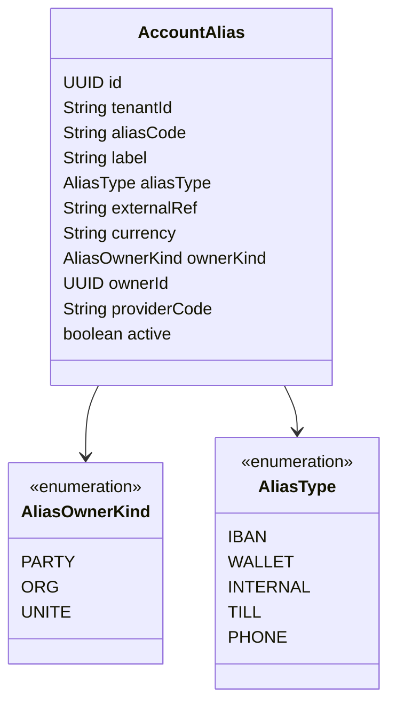

**Lien logique (pas de FK inter-bases) :**

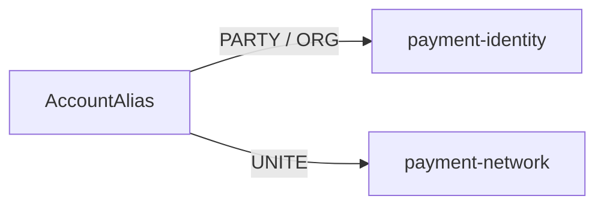

---

### 5.3 payment-network

**Rôle.** Réseau de distribution par zone monétaire.

| Concept | Description |
|---------|-------------|
| `Zone` | Code (UEMOA, CEMAC…), devise, statut |
| `UniteOrganisation` | Nœud de l’arbre |
| `TypeUnite` | `PAYS`, `FSE`, `AGENCE`, `MASTER`, `MARCHAND`, `SOUS_DISTRIBUTEUR`, `REGROUPEMENT` |
| `RegroupementMembre` | N-N : regroupement ↔ unités membres (même zone, dans la branche du parent) |

**Arbre :** `PAYS` › `FSE` › `AGENCE` › (`MASTER` \| `MARCHAND`) › `SOUS_DISTRIBUTEUR`.  
Un **regroupement** se rattache à une unité (jamais racine) ; ses membres couvrent aussi leur descendance.

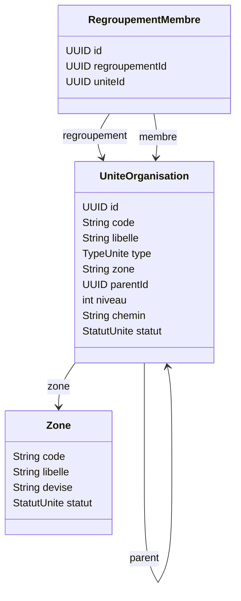

**API utile pricing :** `GET /api/v1/network/positions` — lignée + regroupements couvrants pour une unité / pays / zone.

---

### 5.4 payment-pricing

**Rôle.** Moteur de frais configurables (formules + grilles + tranches).

| Concept | Description |
|---------|-------------|
| `Formule` / `FormuleParametre` | Formule versionnée |
| `GrilleTarifaire` | Cible produit / canal / devise / réseau / période |
| `TrancheTarifaire` | Paramètres JSONB par tranche de montant |
| `CibleReseau` | TOUTES / ZONE / UNITE / REGROUPEMENT |

Pour sélectionner une grille **ciblée**, pricing appelle network (`positions`) avec le token relayé.

---

### 5.5 Gateway (payment-domain / application)

**Rôle.** Exécution des produits : catalogue versionné, BPMN Flowable, capabilities, Omnicanal → connecteurs.

Entités centrales (extrait) : `PaymentTransaction`, `PaymentExecution`, `PaymentEvent`, `CatalogDeService`, `TransferBeneficiary`, `ApprovalInstance`, `Biller`, `ScheduledPayment`, …

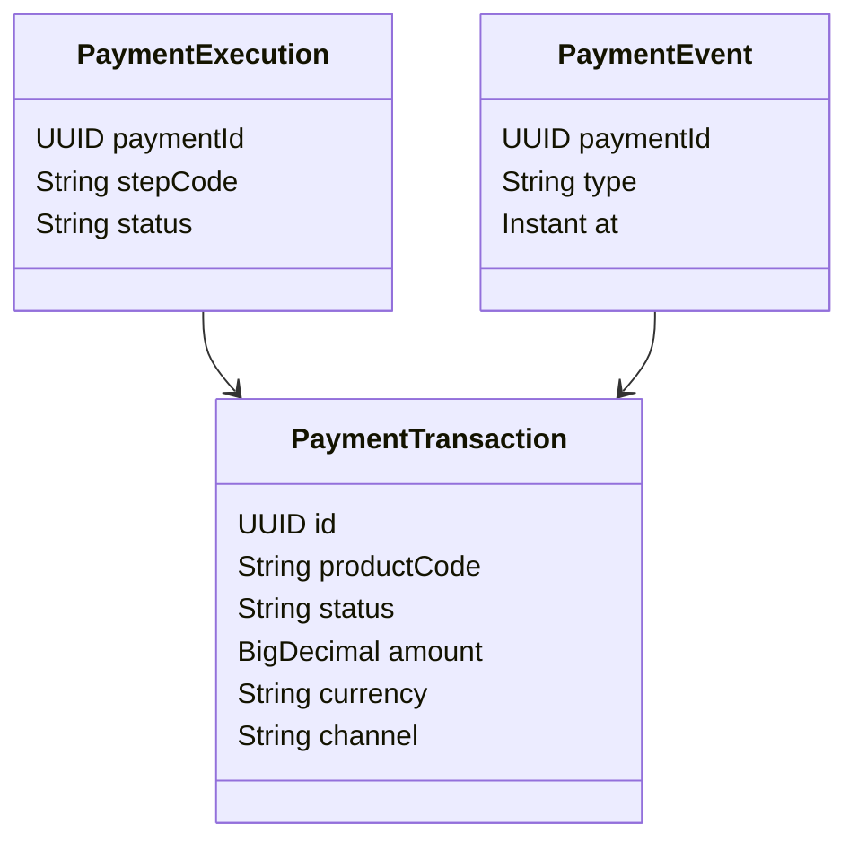

---

### 5.6 Vue transversale identité ↔ réseau ↔ alias ↔ offre

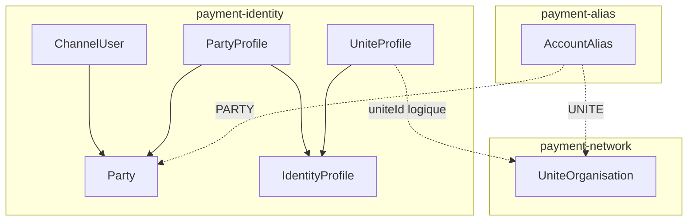

---

## 6. Interactions entre modules

| Appelant | Appelé | Protocole | Objet |
|----------|--------|-----------|-------|
| Clients / fronts | Gateway | HTTPS + JWT | Produits, paiements, catalogue |
| Clients / fronts | Identity | HTTPS + JWT | Parties, users, profils, offre |
| Clients / fronts | Alias | HTTPS + JWT | CRUD / liste / resolve alias |
| Clients / fronts | Network | HTTPS + JWT | Arbre, unités, regroupements |
| Clients / fronts | Pricing | HTTPS + JWT | Grilles, simulation, calcul frais |
| **Pricing** | **Network** | HTTP + Bearer relayé | `GET /positions` (cache court) |
| Identity | Pricing / Gateway | — | **Aucun** (codes stockés, pas d’appel) |
| Alias | Identity / Network | — | **Aucun** (pas de validation owner) |
| Gateway | Connecteurs | HTTP + Resilience4j | Legs Omnicanal |

**Règle d’or :** pas de FK JDBC cross-DB. Les liens sont des **UUID + kind** (alias) ou des **codes stables** (serviceCode, grilleCode dans les profils).

---

## 7. Diagrammes de séquence

### 7.1 Connexion corporate + hydratation org / alias / offre

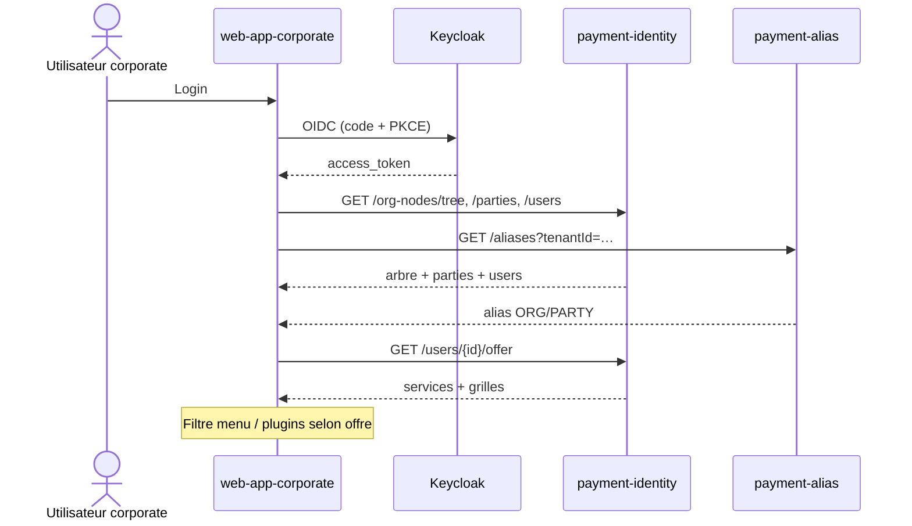

### 7.2 Mobile retail — comptes depuis les alias Party

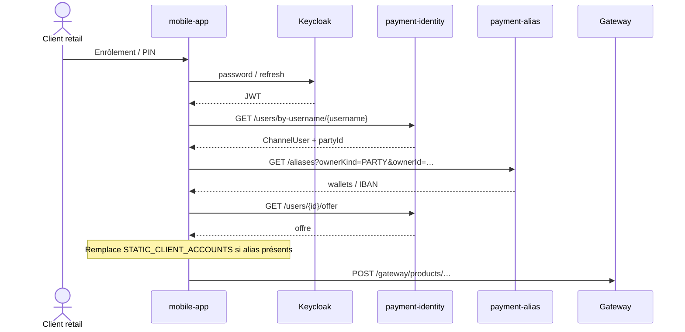

### 7.3 Mobile agent — unité réseau + till + offre

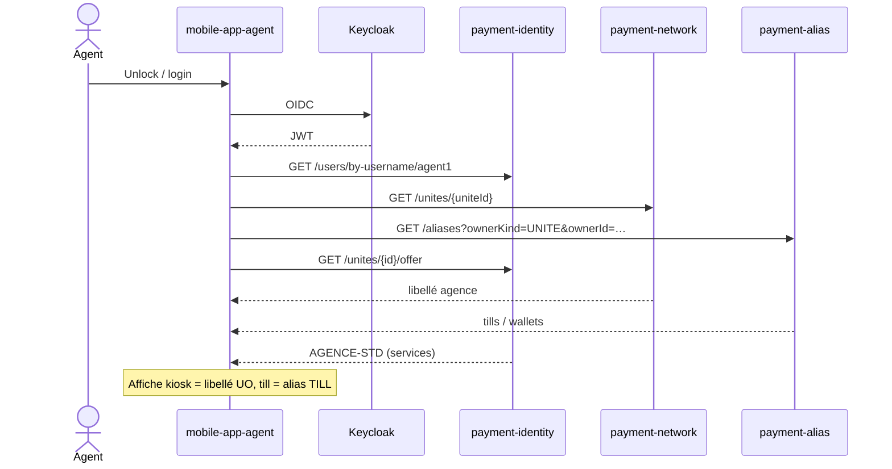

### 7.4 Calcul de frais avec grille ciblée réseau

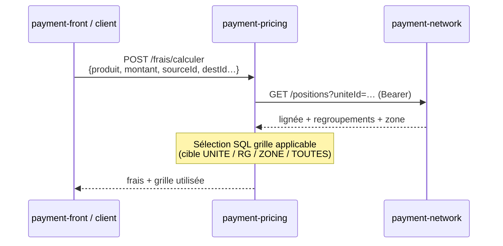

### 7.5 Exécution d’un produit (gateway — simplifié)

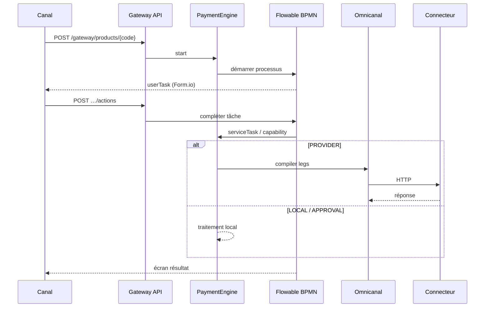

---

## 8. Canaux clients

| Canal | Identity | Alias | Network | Pricing | Gateway | Offre |
|-------|----------|-------|---------|---------|---------|-------|
| **payment-front** | Admin profils + affectation unités | CRUD UNITE sur fiche UO | Arbre / CRUD | Grilles | Admin catalogue | Affichage fiche UO |
| **web-app-corporate** | Org tree, users | ORG/PARTY (comptes virement) | — | — | Produits corporate | Filtre menu via `/users/{id}/offer` |
| **mobile-app** | User by username | PARTY → comptes | — | — | Produits retail | Filtre plugins |
| **mobile-app-agent** | User by username | UNITE → till | UO liée | — | (à étendre) | `/unites/{id}/offer` |

**Proxies (dev) — règle :** chemins spécifiques (`/api/v1/identity`, `/aliases`, `/network`, pricing) **avant** le catch-all `/api` → gateway, sinon 404 « Ressource introuvable ».

---

## 9. Contrats API (résumé)

| Base | Exemples |
|------|----------|
| `/api/v1/gateway/**` | products, bill-payment, payments, transactions |
| `/api/v1/identity/**` | parties, org-nodes, users, profiles, parties/{id}/offer, unites/{id}/profiles \| offer |
| `/api/v1/aliases/**` | list / create / resolve / deactivate |
| `/api/v1/network/**` | zones, unites, arbre, positions, regroupements |
| `/api/v1/frais/**`, `/api/v1/grilles/**` | calcul, grille-applicable, CRUD grilles |

Swagger : `{host}/swagger-ui.html` sur chaque app autonome.

---

## 10. Déploiement local

```bash
# Infra
docker compose up -d   # postgres (gateway, identity, pricing, network, alias), redis, keycloak

# Apps (exemples)
java -jar payment-channel-api/target/payment-gateway.jar --spring.profiles.active=local
java -jar payment-identity/target/payment-identity.jar --spring.profiles.active=local
java -jar payment-alias/target/payment-alias.jar --spring.profiles.active=local
java -jar payment-network/target/payment-network.jar --spring.profiles.active=local
java -jar payment-pricing/target/payment-pricing.jar --spring.profiles.active=local

# Fronts
cd payment-front && ng serve --port 4200 --proxy-config proxy.conf.json
```

Seeds utiles : unités UEMOA/CEMAC (network V1–V4), profils + affectations unités (identity V3/V5/V6), alias Party/Org/UNITE (alias V1).

---

## Annexes

### A. Glossaire

| Terme | Sens |
|-------|------|
| **Profil d’offre** | Gabarit services + grilles (Identity) — ≠ profil d’approbation maker/checker |
| **Alias** | Référence de compte sans solde |
| **Unité (UO)** | Nœud du réseau de distribution |
| **Regroupement** | UO de type REGROUPEMENT + membres N-N |
| **Capability** | Brique d’exécution dans le BPMN gateway |
| **Offre résolue** | Union des profils actifs à une date |

### B. Évolutions récentes (oct. 2026)

- Extraction **payment-alias** hors identity  
- Profils d’offre + affectation **Party** et **UNITE**  
- Regroupements dans l’arbre network (V4)  
- Branchement corporate / mobile / agent sur identity + alias  

### C. Limites connues

- Alias / UniteProfile : pas de vérification d’existence cross-service  
- Lien agent ↔ unité encore mappé en démo (username → UUID) côté mobile-agent  
- Gateway n’appelle pas encore pricing pour le calcul en ligne de transaction  

---

*Document généré pour le dépôt payment-2 — à maintenir avec les migrations Flyway et les README de chaque module.*
