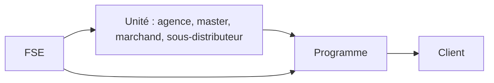

# Fidélité

Ce document décrit la fidélité de payment-2 telle qu'elle fonctionne en novembre 2026 :
le programme, ce qui s'y rattache, qui le définit, et comment les points sont gagnés,
conservés et échangés.

Le service est `payment-fidelite`, port local **8103**, base `payment_fidelite`.
La porte publique est l'API gateway, préfixe `/api/v1/fidelite`. Toute requête exige
un jeton. Le tenant vide retombe sur `CORIS_DEMO`.

---

## 1. Les quatre objets

| Objet | Rôle |
|---|---|
| **Programme** | La règle durable. Il dit combien de points un paiement rapporte, qui peut en bénéficier, combien de temps les points vivent, et ce que le parrainage verse. |
| **Campagne** | Un bonus temporaire posé sur un programme. Elle augmente les points de la règle de base pendant une période, dans un budget. |
| **Mission** | Un objectif posé sur un programme. Une fois la cible atteinte dans une fenêtre, elle verse une prime fixe, une seule fois pour cette fenêtre. |
| **Récompense** | Un article du catalogue du programme. Le client dépense des points pour l'obtenir. |

Campagnes, missions et récompenses n'existent pas seules. Chacune appartient à un programme.

### Exemple en place : Programme Coris

Règle de base : **1 point pour 1 000 F**, parrain **200** points, filleul **80**, validité **3 mois**.

Un paiement de 10 000 F donne 10 points de base.

La campagne **Week-end double** (`WEEKEND_DOUBLE`) multiplie par 2, le samedi et le dimanche (UTC), avec un budget de 5 000 points et le groupe `WEEKEND`. Le même paiement du week-end donne 20 points. Le budget ne finance que les 10 points supplémentaires. Une fois le budget épuisé, la règle de base continue de verser ses 10 points.

Trois missions sont ouvertes sur ce programme, toutes sur une fenêtre d'un mois :

| Code | Objectif | Prime |
|---|---|---|
| `CINQ_PAIEMENTS` | 5 paiements | 100 points |
| `FACTURES_50000` | 50 000 F cumulés | 200 points |
| `PREMIER_PAIEMENT` | 1 paiement | 50 points |

Les filtres de ces missions sont vides : tout paiement du tenant qui concerne un client du programme les fait avancer.

---

## 2. Qui voit quoi

Un **FSE** est une unité de type `FSE` dans le réseau. Une unité d'organisation ne porte pas elle-même de code FSE : son FSE est l'ancêtre de type `FSE` le plus proche. S'il y en a plusieurs dans la lignée, l'écran agent retient le plus proche du parent.

Deux façons de détenir un programme coexistent.

| Détenteur | Où on le définit | Portée habituelle |
|---|---|---|
| Le FSE, via le back-office | `backoffice-app`, menus Programmes, Campagnes, Missions, Récompenses | `TOUS` ou `PROFIL`. Programme Coris est dans ce cas. Son FSE n'est pas renseigné. |
| L'unité, via ses applications | Plugin `fidelite` de `web-app-agent` (`/app/fidelite`) et de `mobile-app-agent` (`/fidelite`) | `UNITE`, avec l'identifiant de l'unité active et le FSE de sa lignée |

L'application client (`mobile-app`, plugin `fidelite`) montre les points au client. Elle ne sert pas à définir un programme. Un programme de portée `UNITE` n'accepte pas l'adhésion spontanée : seule l'unité inscrit ses clients, par `POST /programmes/{id}/clients`.

Le back-office attache campagnes, missions, récompenses, le pilotage et le parrainage au détail du programme. Le catalogue se saisit dans Fidélité, Paramètres, Récompenses. Le menu n'a plus d'entrées Campagnes, Missions, Pilotage ni Parrainages.

---

## 3. Le programme

Création : `POST /api/v1/fidelite/programmes`. Modification : `PUT /api/v1/fidelite/programmes/{id}`. Le code est généré à la création et n'est pas réécrit.

Champs utiles :

| Champ | Sens |
|---|---|
| `pointsParMille` | Points gagnés pour 1 000 F de la règle de base. |
| `pointsParrain`, `pointsFilleul` | Primes de parrainage. |
| `validiteMois` | `3`, `6`, `12`, ou vide pour une durée illimitée. |
| `portee` | `TOUS`, `PROFIL` ou `UNITE`. |
| `profils` | Obligatoire si la portée est `PROFIL`. Ignoré sinon. |
| `uniteId`, `uniteNom` | Obligatoires si la portée est `UNITE`. |
| `fseId`, `fseNom` | Obligatoires à la création et à la modification. |

La portée décide qui entre :

| Portée | Entrée |
|---|---|
| `TOUS` | Le client rejoint le programme lui-même (`POST /programmes/{id}/adhesions`). |
| `PROFIL` | Le client le rejoint si l'appel envoie un code de profil qui figure sur le programme. La fidélité ne lit pas les profils d'Identity. |
| `UNITE` | L'unité inscrit le client. Le client qui tente d'adhérer seul est refusé. |

`GET /unites/{uniteId}/programmes` ne retourne que les programmes actifs dont `unite_id` est exactement cette unité. Les programmes d'un marchand ne remontent pas en filtrant sur le FSE parent.

Un programme nouvellement créé ne propose aucune récompense. Le catalogue `catalogue_recompense` décrit la récompense une seule fois par tenant et par code. `programme_catalogue_recompense` dit quels éléments du catalogue un programme propose, avec son stock, ses dates et son marchand. Ajouter une récompense à un programme réutilise le code déjà présent dans le catalogue, ou le crée s'il est nouveau.

Le parrainage se consulte dans l'onglet du programme. La règle s'y modifie : KYC, montant minimum, délai, plafond mensuel et produits. À la création elle vaut KYC exigé, 5 000 XOF, 30 jours, 20 parrainages par mois et tous les produits. Un délai à 0 retire la limite de temps. Un plafond à 0 bloque les nouvelles primes. Le code est créé par le client déjà inscrit. Le back-office n'en fabrique pas. Un code ouvert n'a pas encore de filleul. Un code associé attend le KYC ou le premier paiement. La prime part une seule fois, au parrain et au filleul.

---

## 4. Comment les points sont gagnés

Un paiement accepté devient un événement (`POST /api/v1/fidelite/events`). Pour le client, le service parcourt **toutes** ses adhésions actives du tenant et crédite chaque programme concerné.

La règle de base s'applique d'abord. Les campagnes du programme ajoutent ensuite un surplus. Les missions avancent sur le même événement et versent leur prime quand la cible est atteinte.

Le lieu du paiement n'entre pas dans ce calcul. Le FSE et l'unité enregistrés sur le programme ne filtrent pas l'attribution. Un client inscrit au programme d'un marché gagne aussi sur un paiement fait ailleurs dans le tenant, et il gagne en parallèle sur Programme Coris s'il y a adhéré.

Les points arrivent par lots, consommés du plus proche à échéance vers le plus lointain (FEFO). Une échéance vide passe en dernier. La durée du lot est `validiteMois` à partir du crédit, en mois UTC. Un lot d'ouverture, sans échéance, couvre les soldes déjà présents avant cette règle. Une passe nocturne (`0 20 2 * * *`) expire les lots arrivés à terme. `POST /expiration` force la même passe ; elle est réservée à l'exploitation.

L'annulation (`POST /annulations`) reprend les points encore présents dont la référence métier commence par l'identifiant du paiement. Les primes de mission, de fenêtre et de parrainage restent en place.

---

## 5. La campagne

Une campagne a des dates, un multiplicateur, un bonus fixe, un budget, une priorité, un groupe, et des filtres : week-end, profils, régions, unité, produits, services, canaux, segment requis, financeur.

Le surplus d'une campagne sur une base `B`, un multiplicateur `M` et un bonus fixe `F` est :

`max(0, plancher(B × M) − B) + max(0, F)`

Le budget ne couvre que ce surplus. La base reste versée quand le budget est épuisé.

Dans un même groupe, la campagne de plus forte priorité l'emporte. Deux groupes différents empilent leurs surplus sur la base d'origine, sans se multiplier entre eux. Une campagne ×2 et une campagne +5 sur 10 points de base donnent 10 + 10 + 5 = 25.

Le segment vu par la campagne est celui du client **avant** l'événement en cours. Le filtre week-end retient le samedi et le dimanche UTC. Un filtre vide retient tout.

Segments calculés sur l'activité : `NOUVEAU`, `ACTIF`, `INACTIF_30`, `INACTIF_60`, `ATTRITION`, `FORTE_VALEUR` (au moins 100 000 XOF sur 30 jours), `QR`.

Écriture, lecture et modification des campagnes exigent un rôle d'exploitation : `ADMIN`, `DIRECTEUR`, `RESPONSABLE_OPERATIONS`, `CHEF_AGENCE`, `AUDITOR`, `OPERATOR`, `CONFIG_MANAGER`.

---

## 6. La mission

| Métrique | Ce qui est compté |
|---|---|
| `COUNT` | Nombre de paiements. |
| `AMOUNT` | Somme des montants. |
| `DISTINCT` | Nombre de `serviceType` distincts. |
| `PREMIER` | Stockée comme métrique. Le compteur avance comme pour `COUNT`. Avec une cible de 1, le premier paiement retenu suffit. |

La fenêtre :

| `fenetreJours` | Fenêtre |
|---|---|
| `30` | Mois calendaire UTC, du 1er au dernier jour. |
| `7` | Blocs de 7 jours alignés sur l'époque. |
| `0` | Toute la durée, une seule fenêtre depuis le 1er janvier 1970. |
| autre valeur positive | Blocs de cette longueur, alignés de la même façon. |

La prime est versée une fois par fenêtre, référence `MISSION:{id}:{partyId}:{debut}`. Un filtre produit, service ou canal vide retient tout paiement. La mission avance pour tout client du tenant dont le paiement passe le filtre, que le client ait adhéré ou non au programme qui porte la mission. Le crédit, lui, est passé sur ce programme.

Même rôle d'exploitation que les campagnes pour créer, lister et modifier.

---

## 7. La récompense

Types : `CATALOGUE`, `BON_MARCHAND`, `REDUCTION`, `DATA`, `FRAIS_OFFERTS`, `CASHBACK`. Un stock vide signifie un stock illimité.

L'échange (`POST /programmes/{id}/recompenses/{code}/echanger`) débite les points et le stock, et enregistre une valeur en XOF. Il ne crédite pas un portefeuille. Un libellé qui parle d'un crédit wallet décrit l'intention. Le mouvement d'argent n'est pas exécuté par ce service.

La modification d'une récompense peut changer son code si le nouveau code est libre sur le programme. Le titre, la description, le coût et le type sont ceux du catalogue : les modifier depuis un programme les modifie pour tous les programmes qui proposent ce code. Le stock, les dates et le marchand restent propres à la liaison. Un stock vide repasse le reste à illimité. La position et l'icône ne bougent pas.

La liste des récompenses est ouverte à toute session authentifiée. La création et la modification exigent l'exploitation.

---

## 8. L'unité définit son programme

Parcours des applications agent :

1. Lire l'unité active. Sur le web, c'est le guichet (`/network/guichet/moi`). Sur le mobile, le même appel. Sans unité, l'écran s'arrête.
2. Lire l'unité et ses ascendants (`/network/unites/{id}` et `/ascendants`).
3. Retenir le FSE : l'unité elle-même si son type est `FSE`, sinon l'ancêtre `FSE` le plus proche.
4. Charger `GET /fidelite/unites/{uniteId}/programmes`. L'écran affiche le plus récent. S'il n'y en a pas, le formulaire de création est proposé.
5. Créer le programme en portée `UNITE`, puis enregistrer la durée par `PUT` si elle vaut 3, 6 ou 12 mois.
6. Chercher le client dans Identity (`/identity/parties/search`) et l'inscrire.

La recherche retient d'abord le numéro qui correspond, sinon le premier résultat de la page. Il n'y a pas d'écran de choix quand plusieurs clients correspondent. Un client déjà inscrit est annoncé comme inscrit : le service ne signale pas le doublon, il l'ignore.

L'écran agent ne modifie pas un programme déjà créé. Il ne gère ni campagne, ni mission, ni récompense : ces écritures répondent 403 à une session agent.

Le lien mobile est sur l'accueil, audiences agent et marchand. Il n'est pas dans la fiche du point de vente.

---

## 9. Autres mouvements

| Mouvement | Effet |
|---|---|
| Transfert de points | Plafond 10 000 points par mouvement, 3 mouvements et 20 000 points par jour. L'échéance du lot reçu est la plus proche entre le lot source et la validité du programme destinataire. |
| Conversion | Enregistre un taux entre deux programmes, ou vers l'argent si le programme cible est vide. Le portefeuille n'est pas crédité. |
| Monétisation | Enregistre la valeur. Le portefeuille n'est pas crédité. |
| Coalition | Un marchand et un pourcentage. La compensation est émissions moins usages. Un marchand déjà présent est refusé. |
| Paliers | Seuils de solde affichés au client. Atteindre un palier ne crédite pas de points supplémentaires. |
| Notification | Un message part seulement si le client a un consentement. L'absence de ligne de consentement bloque l'envoi. Le service écrit une file `A_ENVOYER`. Il n'appelle ni SMS, ni push, ni e-mail, ni WhatsApp. |
| Pilotage | `GET /pilotage/passif` groupe les lots restants par date d'échéance. Une échéance vide est le stock illimité. |

---

## 10. Contrats utiles

Préfixe `/api/v1/fidelite`. Session authentifiée, sauf mention.

| Appel | Usage |
|---|---|
| `POST /programmes` | Créer. |
| `PUT /programmes/{id}` | Modifier nom, portée, unité, profils, points, FSE, durée. |
| `GET /programmes` | Programmes visibles pour le client du jeton. |
| `GET /unites/{uniteId}/programmes` | Programmes actifs de cette unité. |
| `GET /programmes/{id}/clients` | Inscrits : `partyId`, date. |
| `POST /programmes/{id}/clients` | Inscription par l'unité. Corps : `{ "partyId" }`. |
| `POST /programmes/{id}/adhesions` | Adhésion du client. Refusée si la portée est `UNITE`. |
| `GET /programmes/{id}/solde` | Solde et palier. |
| `GET /programmes/{id}/mouvements` | Historique. |
| `GET /programmes/{id}/recompenses` | Catalogue. |
| `POST /programmes/{id}/recompenses/{code}/echanger` | Échange. |
| `POST /events` | Paiement à attribuer. |
| Campagnes, missions, récompenses en écriture, validité dédiée, expiration, annulation, pilotage, notifications globales | Exploitation. |

La liste des clients et l'inscription ne vérifient pas que l'appelant est membre de l'unité qui porte le programme. L'écran envoie l'unité active. Le service accepte l'identifiant tel qu'il est reçu.

---

## 11. Limites actuelles

Ces points sont l'état du code, pas une cible.

- Le FSE et l'unité du programme sont un rattachement. Ils ne restreignent pas les points gagnés au lieu du paiement.
- L'API de création, de liste et d'inscription ne contrôle pas l'appartenance de la session à l'unité.
- L'écran agent montre un seul programme, le plus récent, et ne le modifie pas ensuite.
- L'écran agent ne porte ni campagne, ni mission, ni récompense.
- La recherche client inscrit le premier correspondant, sans confirmation.
- `PREMIER` avance comme un comptage de paiements.
- Une mission avance même sans adhésion au programme qui la porte.
- L'annulation d'un paiement ne reprend ni la prime de mission, ni celle de fenêtre, ni celle de parrainage.
- L'échange, le cashback et la conversion enregistrent une valeur. Ils ne créditent pas un portefeuille.
- Les notifications restent dans une file d'attente.
